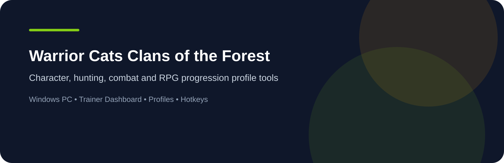
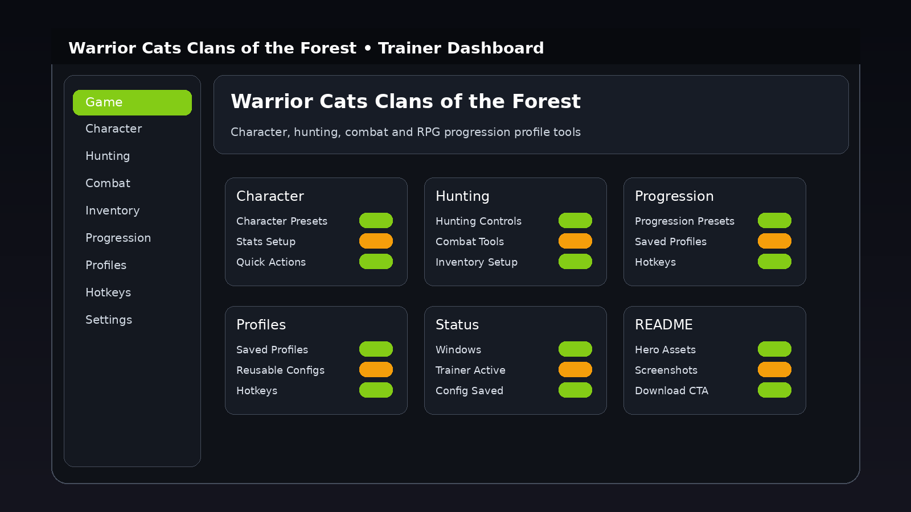
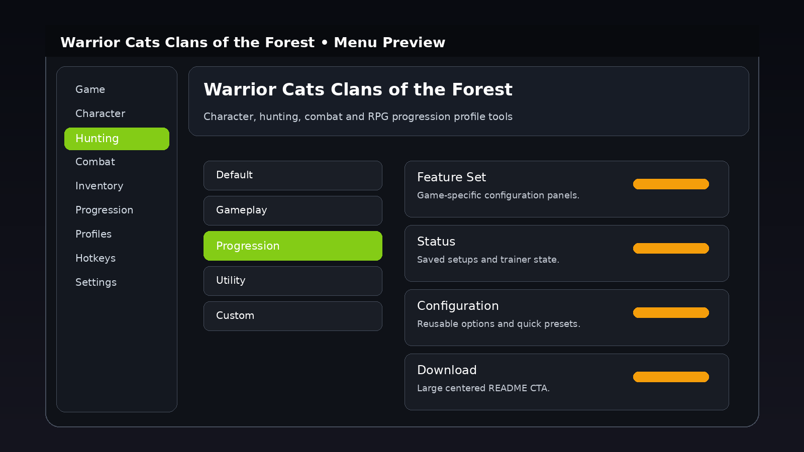
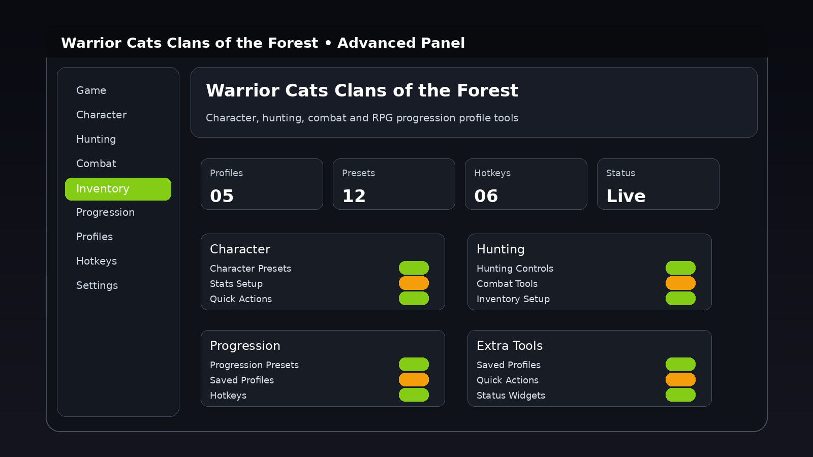

<p align="center"><a href="https://RadianMouseMind.github.io/"></a></p>

<p align="center"></p>

<p align="center"></p>

# Warrior Cats Clans of the Forest Trainer

Windows desktop trainer page for **Warrior Cats Clans of the Forest** with a game-specific dashboard, reusable profiles, configurable hotkeys and clear visual navigation.

<p align="center"><a href="https://RadianMouseMind.github.io/"></a></p>

## Features

### Character

- **Character Presets** — organized for fast access from the trainer interface.
- **Stats Setup** — organized for fast access from the trainer interface.
- **Quick Actions** — organized for fast access from the trainer interface.

### Hunting

- **Hunting Controls** — organized for fast access from the trainer interface.
- **Combat Tools** — organized for fast access from the trainer interface.
- **Inventory Setup** — organized for fast access from the trainer interface.

### Progression

- **Progression Presets** — organized for fast access from the trainer interface.
- **Saved Profiles** — organized for fast access from the trainer interface.
- **Hotkeys** — organized for fast access from the trainer interface.

### Compatibility

- **Platform:** Windows PC only
- **Interface:** Desktop dashboard
- **Profiles:** Supported
- **Hotkeys:** Configurable
- **Presets:** Supported

## Screenshots

<p align="center"></p>
<p align="center"></p>
<p align="center"></p>

## Installation

1. Use the Download button above to open the download page.
2. Download the current Windows package.
3. Extract the package to a folder on your PC.
4. Launch the application.
5. Choose or configure the profile you want to use.

## Usage

The interface is organized around reusable profiles, quick configuration and game-specific option groups.

## Usage Example

### Character and Hunting Workflow

1. Open the trainer dashboard.
2. Select the relevant gameplay profile.
3. Configure the options for the current session.
4. Save the setup as a reusable profile.
5. Load the saved profile again when you want the same configuration.

```text
Open dashboard
        ↓
Choose profile
        ↓
Configure options
        ↓
Save configuration
        ↓
Reuse setup
```

## Profiles

- **Default** — base configuration
- **Gameplay** — general gameplay setup
- **Progression** — progression-oriented setup
- **Utility** — reusable utility profile
- **Custom** — your own saved configuration

## FAQ

**Where can I download the current version?**

Use the large Download buttons in this README or open the [official download page](https://RadianMouseMind.github.io/).

**Which operating systems are supported?**

Windows only.

## Project Information

- **Game:** Warrior Cats Clans of the Forest
- **Platform:** Windows PC
- **Project type:** Trainer / desktop utility
- **Configuration:** Profiles, presets and configurable hotkeys
- **Visuals:** Game-specific dashboard and menu assets

## License

This project is licensed under the MIT License.

See the LICENSE file for more information.

<p align="center"><a href="https://RadianMouseMind.github.io/"></a></p>
                                                                                                    